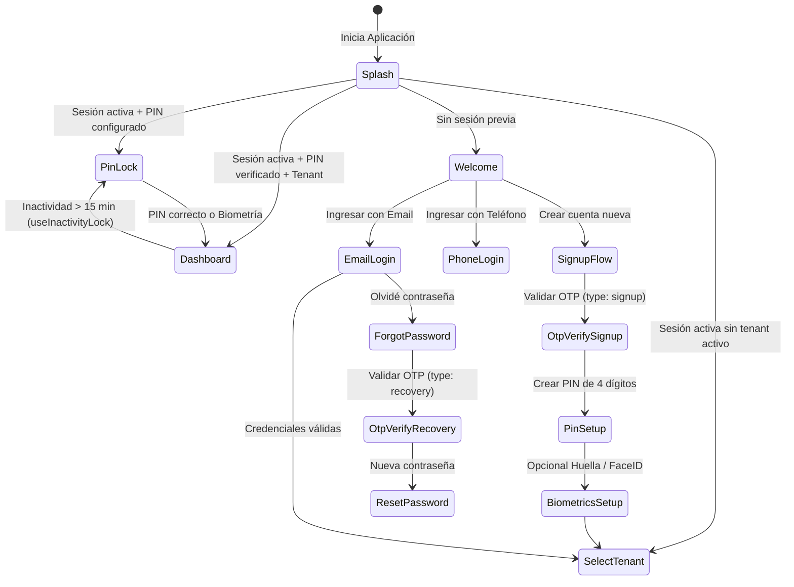

# Vittkly Mobile App (`@vittkly/mobile`) 📱

Aplicación móvil universal para técnicos de campo y cuadrillas operativas de **Vittkly**, construida con **React Native**, **Expo SDK 57**, **Expo Router** y persistencia offline segura.

---

## 🚀 1. Stack Tecnológico Real

- **Runtime & Framework:** [Expo SDK 57](https://expo.dev) (`~57.0.30`) con [React Native 0.86.3](https://reactnative.dev) y [React 19.2.3](https://react.dev)
- **Navegación:** Expo Router (`~57.0.28`) con estructura de rutas delgadas en `src/app/`
- **Seguridad Nativa & Hardware:** `expo-secure-store` (`~57.0.4`) y `expo-local-authentication` (`~57.0.3`)
- **Persistencia Offline:** `expo-sqlite` (`~57.0.4`) para sesiones y caché local
- **Backend & Auth:** `@supabase/supabase-js` (`^2.109.0`) conectado a Supabase Cloud (`sa-east-1`)
- **Estado Asíncrono:** `@tanstack/react-query` (`^5.104.3`)
- **UI & Animaciones:** `react-native-reanimated` (`4.5.1`), `react-native-safe-area-context` y `lucide-react-native`
- **Monorepo Packages:** Consumo directo de `@vittkly/shared` y `@vittkly/db-types`

---

## 🔐 2. Módulo de Autenticación y Seguridad Offline (`src/features/auth/`)

La aplicación móvil cuenta con un sistema completo y auditado de autenticación híbrida (Online Cloud + Offline First):



### Funcionalidades Implementadas en Código:
1. **Flujo de Registro con Verificación OTP Obligatoria:**
   - `SignupScreen`: Paso de datos de usuario (`SignupAccountStep`) y empresa (`SignupCompanyStep`).
   - `auth.service.signUpWithEmail`: Registro contra Supabase Cloud.
   - `auth.service.verifySignupOtp`: Validación estricta con `supabase.auth.verifyOtp({ type: 'signup' })`. No permite acceso si el token es incorrecto o expiró.
2. **Recuperación de Contraseña Segura:**
   - `ForgotPasswordScreen`: Solicitud de código y pantalla de validación OTP (`ForgotVerifyStep`).
   - `auth.service.verifyRecoveryOtp`: Verificación estricta con `supabase.auth.verifyOtp({ type: 'recovery' })`.
   - `auth.service.updatePassword`: Actualización de la clave únicamente tras haber validado el OTP de recovery.
3. **PIN Pad Táctil Ergonómico de Alta Precisión (`PinPadLock.tsx`):**
   - Rejilla táctil de botones numéricos con dimensión ergonómica de **72×64px** (`KEY_WIDTH = 72`, `KEY_HEIGHT = 64`) diseñada para uso en campo (con guantes o una sola mano).
   - Feedback háptico nativo en pulsación (`Vibration.vibrate`) y animación visual en caso de error.
   - Integración nativa de slot biométrico (Huella dactilar / FaceID).
4. **Almacenamiento Seguro y Persistencia Offline:**
   - `secureStorageService`: Resguardo seguro en hardware mediante `expo-secure-store` para el hash del PIN (`vittkly_pin_hash_v1`), token de sesión y última marca de tiempo.
   - `offlineSessionService`: Caché local de tenant y perfil en `expo-sqlite` para arranque instantáneo sin red en zonas sin cobertura.
5. **Bloqueo Automático por Inactividad (`useInactivityLock.ts`):**
   - Monitor de ciclo de vida (`AppState`). Si la aplicación permanece en segundo plano durante **15 minutos o más** (`INACTIVITY_LOCK_MS = 15 * 60 * 1000`), la sesión se bloquea automáticamente y exige ingresar el PIN o autenticarse con biometría.

---

## 🎨 3. Design Tokens y Sistema de Diseño (`src/theme/`)

Todo componente visual respeta estrictamente los tokens centralizados en `src/theme/tokens.ts`:

- **Modos:** Soporte nativo para `light` y `dark`.
- **Colores Semánticos Principales:**
  - Superficie: `colors.light.surface` (`#F3F8FA`) / `colors.dark.surface` (`#0A1C27`).
  - Tinta/Texto: `colors.light.ink` (`#0E2A3B`) / `colors.dark.ink` (`#E7F1F6`).
  - Primario Acción: `colors.light.primary` (`#157AA8`).
  - **Kleanly / Success:** `#3EC49B` (`tokens.colors.primary.kleanly`). **Exclusivo para estados completados, pagados o éxito operativo**.
- **Tipografía:** Tipografías Manrope (`Regular`, `Medium`, `SemiBold`, `Bold`, `ExtraBold`) y tipografía monoespaciada para cronómetros/códigos con `tabular-nums`.
- **Accesibilidad Táctil:** Altura mínima de controles estándar `tokens.control.lg` (48px) y teclado numérico `72×64px`.

---

## ⚙️ 4. Configuración y Variables de Entorno

Crea el archivo `.env.local` en esta carpeta a partir de `.env.example`:

```bash
cp .env.example .env.local
```

### Variables Requeridas:
```env
# URL del proyecto Supabase Cloud (sa-east-1)
EXPO_PUBLIC_SUPABASE_URL=https://your-project-ref.supabase.co

# Llave pública de cliente Supabase
EXPO_PUBLIC_SUPABASE_ANON_KEY=your-anon-publishable-key
```

---

## 📱 5. Ejecución en Entornos de Desarrollo

Desde la raíz del monorepo ejecuta:

```bash
# Iniciar Metro Bundler
pnpm dev:mobile
```

O desde el directorio de la aplicación (`apps/mobile`):
```bash
# Iniciar con menú interactivo de Expo
pnpm start

# Abrir directamente en emulador de Android
pnpm android

# Abrir directamente en simulador de iOS (macOS requerido)
pnpm ios
```

---

## 🔧 6. Troubleshooting y Preguntas Frecuentes

### ¿El bundler arroja advertencias de ciclo de dependencias?
Todas las importaciones dentro de `src/features/auth/` utilizan rutas relativas directas a archivos individuales. Si añades un nuevo componente o pantalla dentro del módulo, asegúrate de **no importar desde el propio `index.ts`**.

### ¿Problemas de resolución de paquetes en el monorepo?
Limpia la caché de Metro Bundler e inicia de nuevo:
```bash
npx expo start -c
```
Gracias a la directiva `node-linker=hoisted` en la raíz, los paquetes `@vittkly/shared` y `@vittkly/db-types` se resuelven sin conflictos de symlinks.
