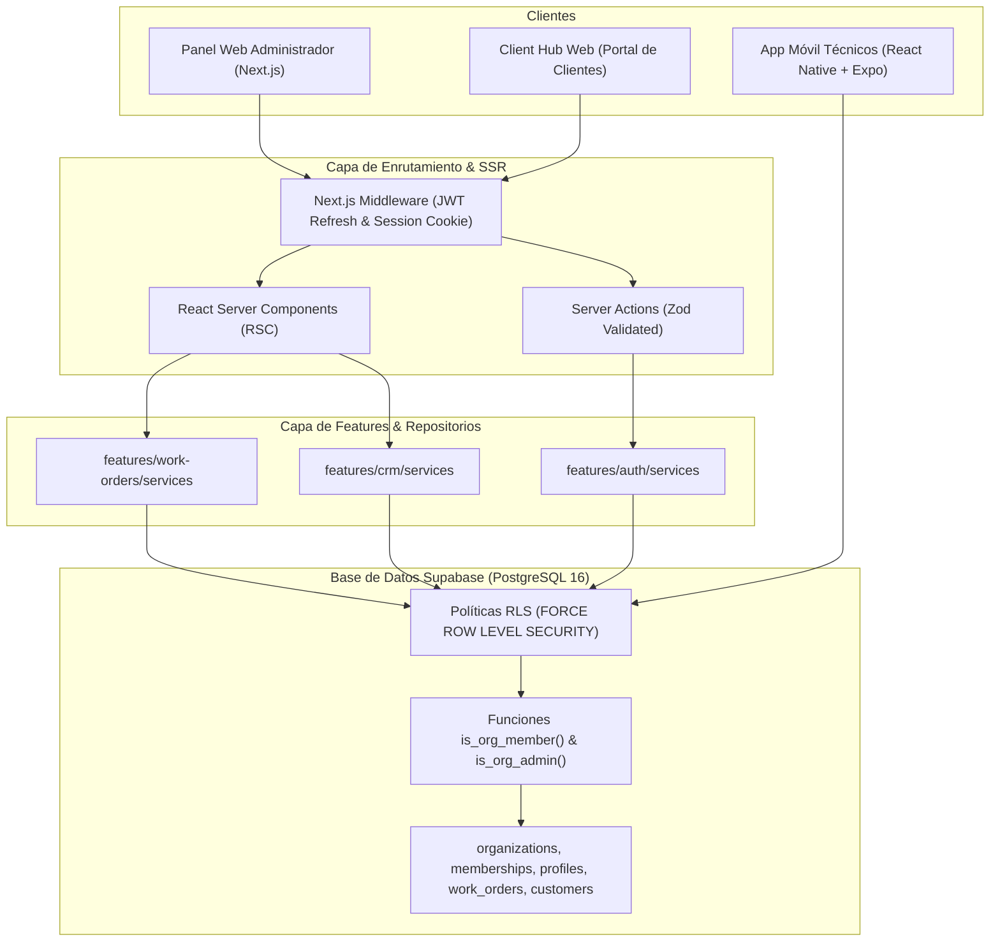

# ADR-0001: Arquitectura Web Next.js App Router y Supabase SSR Multi-Tenant

- **Estado:** Aprobado
- **Fecha:** Octubre 2026
- **Contexto:** Plataforma Web Vittkly SaaS (Panel Administrador, Despacho y Client Hub)

---

## 1. Contexto y Problema

Vittkly requiere una plataforma web de alto rendimiento, accesible y segura para despachadores, administradores y clientes de empresas de servicios en campo. La solución debe coexistir con la aplicación móvil nativa (`Vittkly-App`), compartiendo el mismo backend PostgreSQL en Supabase con aislamiento estricto multi-tenant vía RLS.

---

## 2. Decisión Arquitectónica

Se adopta:

1. **Next.js 16+ con App Router y React 19:**
   - Server Components por defecto para optimizar el bundle del cliente.
   - Thin Routing: `src/app/` solo orquesta páginas delgadas; la lógica de negocio reside en `src/features/`.
2. **Supabase SSR (`@supabase/ssr`):**
   - Cookies HTTP-only seguras con refresco automático de tokens JWT en `middleware.ts`.
   - Patrón Repositorio en `src/features/[feature]/services/` para aislar el acceso a la base de datos.
3. **Sistemas de Diseño Unificado:**
   - Tokens sincronizados con el UI Kit de Vittkly vía variables CSS y Tailwind CSS.

---

## 3. Diagrama de Arquitectura Global (Web + Móvil + Supabase)

---

## 4. Consecuencias y Compromisos

- **Positivo:** Aislamiento total entre organizaciones; prevención de fugas de datos (VULN-01/02/03).
- **Positivo:** Cero duplicación de lógica de base de datos entre Web y Móvil.
- **Regla Estricta:** Prohibido importar `@/lib/supabase/*` en componentes de presentación (`src/components/` o `src/app/**`). Todo acceso pasa por repositorios tipados.
