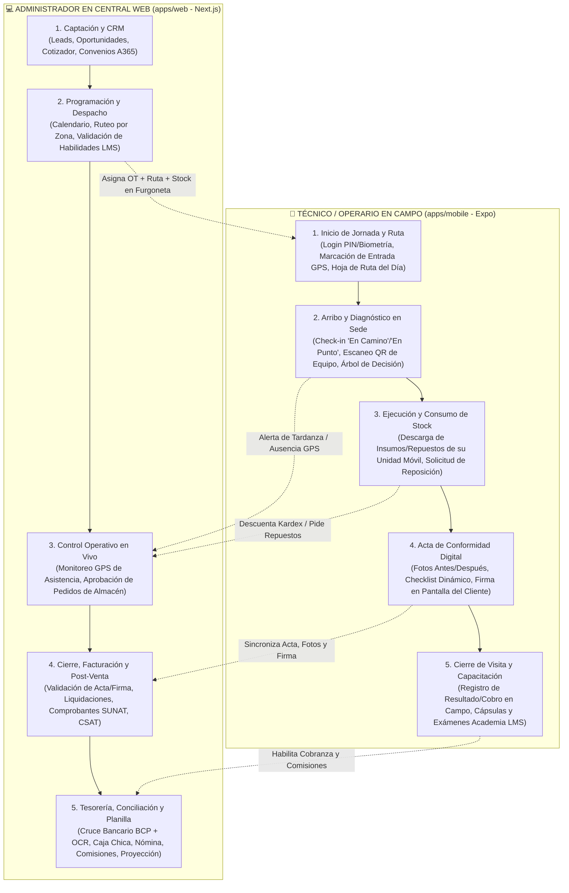
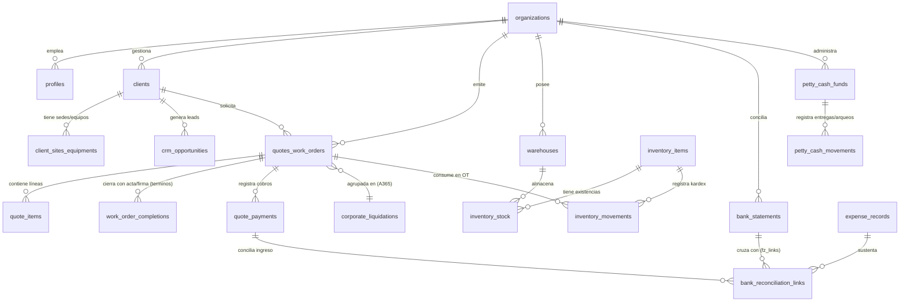
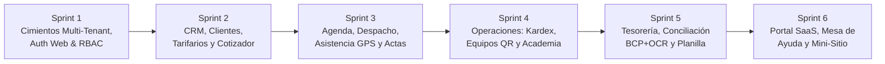

# Auditoría Técnica e Ingeniería Inversa: Paquete Interactivo Vittkly (`docs/artifacts/Demo/completa/`)

> [!IMPORTANT]
> **Alcance de esta Auditoría:** Se inspeccionó el 100 % del paquete ubicado en [`docs/artifacts/Demo/completa/`](file:///home/wilmerabanto/Proyectos/vittkly-monorepo/docs/artifacts/Demo/completa/index.html) (**25,820 líneas de código** distribuidas entre `index.html`, `fz/caja-bancos.js`, `ops/ops.js`, `saas/panel.js`, `saas/mesa.js`, `saas/cuenta.js` y `tess/`) **sin modificar ningún archivo productivo** en `apps/`, `packages/` ni `supabase/`.

---

## 1. Mapa de Módulos y Flujos

### 1.1 Inventario Técnico de Archivos del Artefacto

| Archivo | Líneas | Punto de Montaje / Namespace | Aislamiento UI | Propósito Principal |
| :--- | :---: | :--- | :--- | :--- |
| [`index.html`](file:///home/wilmerabanto/Proyectos/vittkly-monorepo/docs/artifacts/Demo/completa/index.html) | 19,743 | Global SPA (`switchTab`, `RAWDB`, `db` proxy multi-tenant `empresas/<empId>/*`) | DOM Principal + Top/Side Nav (`nvSide`) | **Core CRM, Cotizador, Operaciones de Campo, Agenda, Post-Venta, Finanzas Base, RRHH/Planilla y Configuración.** |
| [`fz/caja-bancos.js`](file:///home/wilmerabanto/Proyectos/vittkly-monorepo/docs/artifacts/Demo/completa/fz/caja-bancos.js) | 2,303 | `window.FZ_MOUNT(host, ctx)` | Shadow DOM (`host.attachShadow({ mode: 'open' })`) | **Tesorería, Flujo de Caja, Conciliación Bancaria 4-Vías (con OCR BCP), Caja Chica, Préstamos de Socios, Proyecciones y Reporte Contable SUNAT.** |
| [`ops/ops.js`](file:///home/wilmerabanto/Proyectos/vittkly-monorepo/docs/artifacts/Demo/completa/ops/ops.js) | 1,314 | `window.VK_OPS_MOUNT(host, ctx)` | DOM Inyectado (`vk-ops` scope) | **Almacenes/Kardex Multi-Sede, Activos/Equipos con QR, Biblioteca de Protocolos (Árboles de Decisión) y Academia LMS (Cursos + Certificados + Habilidades).** |
| [`saas/panel.js`](file:///home/wilmerabanto/Proyectos/vittkly-monorepo/docs/artifacts/Demo/completa/saas/panel.js) | 1,301 | `window.SAAS_MOUNT(host, ctx)` / `window.VK_SAAS` | Shadow DOM | **Backoffice Super-Admin SaaS B2B:** Gestión de Empresas (Tenants), Planes, Módulos, Créditos, Cupones, Dunning/Cobranza SaaS, Unit Economics, Estado del Sistema y Legal/ANPD. |
| [`saas/mesa.js`](file:///home/wilmerabanto/Proyectos/vittkly-monorepo/docs/artifacts/Demo/completa/saas/mesa.js) | 655 | `window.VK_MESA` (Admin + Widget cliente) | Shadow DOM / Modal | **Mesa de Ayuda (Tickets con SLA y auto-cierre 96h), Foro de Comunidad, Guías del Centro de Ayuda y Tablero Kanban de Ideas/Votación.** |
| [`saas/cuenta.js`](file:///home/wilmerabanto/Proyectos/vittkly-monorepo/docs/artifacts/Demo/completa/saas/cuenta.js) | 504 | `window.VK_CUENTA_MOUNT(host, ctx)` | DOM Inyectado (`vkc` scope) | **Portal Self-Service del Tenant ("Mi cuenta Vittkly"):** Suscripción/Cuotas, Creador de Mini-Sitio Web + Reservas Online, Marketing/Reseñas, API/Webhooks, Importador y Seguridad 2FA. |
| [`tess/*`](file:///home/wilmerabanto/Proyectos/vittkly-monorepo/docs/artifacts/Demo/completa/tess/worker.min.js) | Binarios WASM | `Tesseract.createWorker` (invocado en `fz/caja-bancos.js`) | Web Worker | **Motor OCR Offline (Tesseract.js v5.1.1 + LSTM WASM)** para lectura de capturas de estados de cuenta bancarios BCP. |

---

### 1.2 Desglose Funcional Detallado por Archivo

#### A. [`fz/caja-bancos.js`](file:///home/wilmerabanto/Proyectos/vittkly-monorepo/docs/artifacts/Demo/completa/fz/caja-bancos.js#L1-L2303) — Tesorería, Conciliación y Proyección Financiera
Se monta dentro de la pestaña **Finanzas → Caja y bancos** recibiendo el puente `window.FZO` desde `index.html` (`FZO.cobros()` que expone los pagos de cotizaciones y liquidaciones de la Central):
1. **Flujo de Caja (`flujo`, L719–L810):**
   - Clasifica movimientos reales en **Flujo Operativo (FCO)**, **Flujo de Inversión (FCI: equipos/activos)** y **Flujo de Financiamiento (FCF: préstamos/aportes de socios)**.
   - Renderiza un velocímetro visual tipo tanque con olas animadas (`<svg>` wave) que compara el **Saldo Actual en Bancos** contra el **Umbral Mínimo de Seguridad** (`umbralMinimo`, por defecto `S/ 5,000`).
2. **Cruce Bancario y Conciliación 4-Vías (`conciliacion`, L811–L961):**
   - Cruza 4 fuentes: **(1) Extracto Bancario BCP (`fz_banco`)**, **(2) Respuestas de Google Forms de Gastos (`fz_gastos`)**, **(3) Movimientos rápidos manuales (`fz_movs`)** y **(4) Cobros registrados en Cotizaciones/Convenios (`FZO.cobros()`)**.
   - Soporta conciliación **1 a 1**, **1 a N** y **N a 1** mediante la colección `fz_links` (`id = b__g`).
   - **Motor de Sugerencias Automáticas (`autoConciliar`, L1848–L1868):** Empareja por número de operación exacto (`opMatch`, score `1000`) o por coincidencia exacta de monto dentro de una ventana de `±7 días`.
   - **Cierre Mensual Contable (`cerrados`):** Bloquea la edición o eliminación de movimientos en meses cerrados (`YYYY-MM`).
3. **Detector de Duplicados (`duplicados`, L962–L1007):**
   - Algoritmo de 3 niveles de severidad:
     - **Alta:** Mismo comprobante (`RUC + Serie + Número`).
     - **Media:** Misma fecha + misma persona + mismo monto + descripción similar.
     - **Baja:** Mismo monto y persona con `±1 día` de diferencia, o duplicidad entre registro rápido manual y formulario de gastos.
4. **Caja Chica Multi-Fondo (`caja`, L1008–L1079):**
   - Soporta múltiples cajas chicas (`cajas: [{ id, nombre, responsable, fondo }]`), movimientos de `apertura`, `entrega`, `rendicion` (con opción de reposición inmediata) y `arqueo` físico (calculando sobrantes o faltantes frente al saldo teórico).
5. **Préstamos y Cuenta Corriente de Socios (`socios`, L1080–L1150):**
   - Rastrea gastos pagados con dinero personal del socio (`pagadoPor: "Socio: <Nombre>"`), inyecciones de capital (`apo:<socio>`) y devoluciones (`dev:<socio>`), manteniendo el saldo neto adeudado por la empresa a cada socio.
6. **Proyección de Flujo de Caja Multi-Escenario (`proyeccion`, L1151–L1486):**
   - Simulación día a día en **7 horizontes temporales** (`dia` 30d, `sem13` 13 sem, `sem` 26 sem, `mes` 12m, `tri` 8 trim, `seme` 4 semestres, `anio` 3 años) y **3 escenarios** (`pes` Pesimista, `base` Base, `opt` Optimista).
   - Combina automáticamente: cobros programados de trabajos agendados, cotizaciones pendientes ponderadas por `% de probabilidad de cierre`, meta mensual de ventas nuevas, gastos fijos recurrentes (`rec`), y cronograma de devolución de deuda a socios (`modo: 'fijo'` vs `'auto'` cuando la caja supera el mínimo).
   - Permite guardar **Instantáneas ("Fotos" `fotos`)** para comparar **Real vs. Proyectado** por período.
7. **Reporte para Contador / SUNAT (`contador`, L1487–L1579):**
   - Calcula automáticamente Base Imponible (`Monto / 1.18`) e **IGV (18%)** para facturas con RUC válido (11 dígitos que inician en `10` o `20`), alerta gastos sin sustento tributario y exporta un libro Excel `.xlsx` de 6 hojas (*Resumen, Banco, Gastos Socios, Sin Comprobante, Cobros, Caja Chica*).

---

#### B. [`ops/ops.js`](file:///home/wilmerabanto/Proyectos/vittkly-monorepo/docs/artifacts/Demo/completa/ops/ops.js#L1-L1314) — Operaciones: Inventario, Equipos con QR y Academia LMS
Cuenta con un conmutador en vivo de rol (`O.verComo = 'admin' | '<Nombre Técnico>'`) y plantillas precargadas por rubro (`limpieza`, `aire`, `ascensor`):
1. **Módulo 1: Inventario y Equipos (`O.mod = 'inventario'`, L556–L870):**
   - **Catálogo Triple (`items`):**
     - `insumo` (consumibles con control de lotes y fecha de vencimiento `lotes: [{ cod, vence, cant }]`).
     - `repuesto` (piezas con control de números de serie `series`, costo y precio de venta facturable al cliente `precio`).
     - `herramienta` (activos propios asignables a técnicos con frecuencia de mantenimiento preventivo `mantCadaMeses`).
   - **Multi-Almacén (`alms`):** Almacén `central`, Unidades móviles/furgonetas (`unidad`, asignadas a un técnico) y Sedes de cliente (`sede`).
   - **Kardex Valorizado (`movs`):** Registra `ingreso` (recalculando costo promedio ponderado), `transferencia` entre almacenes, `consumo` (vinculado a OT/cotización, sede y equipo, descontando por lote/serie), `ajuste` de inventario y `baja` por merma/vencimiento.
   - **Solicitudes de Reposición de Campo (`pedidos`):** El técnico solicita insumos/repuestos desde su móvil (`pendiente` → Admin `aprobado` y ejecuta transferencia automática a la furgoneta del técnico → `rechazado`).
   - **Equipos del Cliente y QR (`equipos`):** Ficha técnica de activos instalados en sedes del cliente, generación de etiqueta **QR SVG integrable** (`VITTKLY:EQUIPO:<codigo>`), alerta de próximo mantenimiento preventivo y trazabilidad de garantías de repuestos con serie instalados en ese equipo.
2. **Módulo 2: Biblioteca de Protocolos y Academia LMS (`O.mod = 'academia'`, L872–L1185):**
   - **Biblioteca Operativa (`arts`):** Artículos categorizados en `protocolo`, `ficha` (hoja de seguridad MSDS), `manual`, `politica`, `video`, `faq` y `tip`.
   - **Árboles de Decisión Interactivos (`renderArbol`, L941–L961):** Sintaxis declarativa (`?? ¿Pregunta de diagnóstico?` / `=> Opción A :: Acción recomendada`) que guía paso a paso al técnico en campo para resolver fallas.
   - **Confirmación de Lectura Obligatoria (`lect`) e Historial de Versiones (`hist`):** Exige firma de lectura al técnico cuando un protocolo crítico se actualiza; permite a técnicos en campo proponer mejoras (`estado: 'propuesto'`).
   - **Detector de Vacíos de Conocimiento (`busq`):** Registra búsquedas sin resultados hechas por los técnicos para que el administrador redacte nuevos manuales.
   - **Academia LMS y Matriz de Habilidades (`cursos`, `examen`, `cert`, `habs`):** Cursos compuestos por cápsulas de lectura + examen de opción múltiple con nota mínima aprobatoria (`aprobacion` %). Al aprobar, emite un **Certificado Digital (`VK-XXXX`)** y desbloquea automáticamente la **Habilidad (`hab`)** en el perfil del técnico, habilitándolo en la agenda para ese tipo de servicio.

---

#### C. [`saas/panel.js`](file:///home/wilmerabanto/Proyectos/vittkly-monorepo/docs/artifacts/Demo/completa/saas/panel.js#L1-L1301), [`saas/mesa.js`](file:///home/wilmerabanto/Proyectos/vittkly-monorepo/docs/artifacts/Demo/completa/saas/mesa.js#L1-L655) y [`saas/cuenta.js`](file:///home/wilmerabanto/Proyectos/vittkly-monorepo/docs/artifacts/Demo/completa/saas/cuenta.js#L1-L504) — Capa B2B SaaS Multi-Tenant
1. **`saas/panel.js` (Super-Admin Vittkly Cloud):**
   - Gobierno de empresas suscritas (`clientes`), planes (`inicia` S/ 89, `crece` S/ 189, `empresa` S/ 349), feature flags de **22 módulos** (`modulos`), paquetes de créditos prepago (`creditos`), cupones promocionales (`cupones`), campañas (`campanas`), motor de retención anti-churn (`retencion`), reglas automatizadas de cobranza/dunning (`reglas`: días de prueba, reintentos de cobro, gracia, modo solo-lectura, suspensión y purga de datos), facturación SaaS (`facturas`), **Unit Economics** por tenant (`costos`: gasto en DB/Storage/WhatsApp/Mapas vs. MRR), monitoreo de salud e incidentes (`sistema`), cumplimiento legal/ANPD (`legal`), configuración multi-país (`paises`: PE, CL, CO, MX) y RBAC interno del staff de Vittkly con flujo de aprobaciones comerciales (`staff`, `roles`, `aprobaciones`, `auditoria`).
2. **`saas/mesa.js` (Soporte Omnicanal, Comunidad y Roadmap):**
   - **Bandeja de Tickets (`vk_tickets`):** Cálculo automático de SLA según prioridad (`urgente` 60m, `alta` 240m, `normal` 24h, `baja` 48h), respuestas públicas vs. notas internas, macros rápidas, calificación CSAT y **cierre automático tras 96h** sin respuesta del cliente.
   - **Comunidad (`vk_com`) e Ideas (`vk_ideas`):** Foro de preguntas y respuestas entre empresas usuarias (con insignia de respuesta oficial y solución aceptada) y tablero Kanban de 6 columnas (`nueva`, `revision`, `planificada`, `desarrollo`, `publicada`, `descartada`) con votación ponderada por MRR y fusión de ideas duplicadas.
3. **`saas/cuenta.js` (Portal de Autogestión del Tenant):**
   - **Mi Plan (`vkplan`):** Checklist de activación en 10 minutos, barras de consumo de cuotas (usuarios, WhatsApp, comprobantes SUNAT, API), billetera de créditos Vittkly, compra de addons y programa de referidos.
   - **Mini-Sitio Web y Reservas (`vksitio`):** Generador de landing page pública (`<slug>.vittkly.com` o dominio propio CNAME) con previsualizador interactivo en pantalla de iPhone (`telefono()`), cotizador/agendador online para clientes finales y pasarelas de pago (`Culqi`, `Mercado Pago`, `Izipay`, `Niubiz`, `Openpay`).
   - **Marketing (`vkmkt`), API/Webhooks (`vkapi`), Datos (`vkdatos`) y Seguridad (`vkseg`):** Solicitud automática de reseñas en Google tras cada servicio, integración con Meta Lead Ads, llaves API (`vk_live_...`), webhooks con log de reintentos, importador Excel con deduplicación y control de sesiones/2FA.

---

#### D. [`index.html`](file:///home/wilmerabanto/Proyectos/vittkly-monorepo/docs/artifacts/Demo/completa/index.html#L1-L19743) — Core Operativo, Comercial y Administrativo
Orquesta todo el ciclo de vida del negocio en dos modalidades operativas configurables (`AJ.modeloOp`: **Por visita / orden puntual**, **Por contrato / personal destacado**, o **Ambos**):
- **Comercial y CRM:** Tablero de inicio (`dashboard`), Embudo Kanban de Oportunidades (`oportunidades`), Base de Clientes (`clientes`) con deduplicación/fusión y mapa de sedes, Cotizador multi-tarifario (`nueva`, `historial`, `papelera`) con Constructor de Ítems, Tarifario Estándar y Tarifario **A365 (Convenios corporativos)**, Carga Masiva de Leads (`carga`) y Política inteligente de penalidades por cancelación (`cancelPol`).
- **Operaciones de Campo y Post-Venta:** Calendario y Ruteo inteligente con agrupación geográfica (`calendario`, `programar`, `ruta`), Vista móvil de trabajos del día (`trabajos`), **Control de Tiempo, Asistencia y Reemplazos con GPS (`tiempo`, `marcaciones`, `mc_semanas`, `mc_ausencias`)**, Actas de Conformidad y Formularios dinámicos con **Firma Digital en Canvas y Grilla Fotográfica (`terminos`, `formularios`)**, Seguimiento Post-Venta y Garantías (`postventa`), Costeo real por Orden de Trabajo (`costeo`) y Rentabilidad (`rentabilidad`).
- **Finanzas Base y RRHH (`finanzas`):** Cobranzas (`cobranzas`), Liquidaciones corporativas y división por razones sociales (`liquidaciones` / `a365`), Emisión de Comprobantes SUNAT (`comprobantes`), y **Planilla / Pagos al Personal (`personal`: sueldos, horas extra, bonos, adelantos, descuentos en `nom_periodos` y `nom_ajustes`, más motor de Comisiones de Venta y Cartera de Ejecutivos)**.

---

### 1.3 Flujo del Usuario Administrador (Web) vs. Flujo Operativo de Campo (Móvil)

| Dimensión | Flujo Administrador en Web (`apps/web`) | Flujo Operativo de Campo (`apps/mobile`) |
| :--- | :--- | :--- |
| **Objetivo Primario** | Vender, planificar capacidad, controlar márgenes, conciliar bancos y facturar. | Ejecutar servicios a tiempo, documentar evidencia técnica, cuidar su stock móvil y cobrar/cerrar sin fricción. |
| **Vistas Clave en el Artefacto** | `dashboard`, `nueva`, `clientes`, `calendario`, `finanzas` (`caja-bancos.js`, `cobranzas`, `liquidaciones`, `personal`), `config`, `cuenta.js`. | `trabajos` ("Mis servicios de hoy"), `ruta`, `tiempo` (Marcación GPS), `terminos`/`formulario` (Acta + Firma + Fotos), y `ops.js` con `verComo = Técnico`. |
| **Interacción con Inventario** | Crea almacenes, registra compras (`ingreso`), aprueba/rechaza pedidos y audita valorización total. | Ve **solo el stock de su unidad móvil**, registra `consumo` en la OT, escanea el QR del equipo y solicita reposición (`pedidos`). |
| **Interacción con Academia** | Redacta protocolos, diseña árboles de decisión, revisa búsquedas sin resultado y crea exámenes. | Consulta protocolos paso a paso en sitio, confirma lectura obligatoria, propone mejoras desde campo y rinde exámenes para desbloquear habilidades. |
| **Restricción de Permisos** | Acceso total o segmentado por perfil administrativo (`PERFIL.tabs`, aprobaciones de descuentos/eliminación). | Modo enfocado sin distracciones financieras (`USU.tecWeb` restringe pestañas a agenda propia, marcación, actas e inventario de su unidad). |

---

## 2. Extracción del Modelo de Dominio (Base de Datos en Supabase)

El artefacto interactivo utiliza un adaptador tipo Firestore (`db.collection(...)` y `db.doc('meta/...')`) enmarcado bajo un **proxy de aislamiento Multi-Tenant** (`empresas/<tenant_id>/*`, líneas 1966–2008 de `index.html`) más colecciones globales de plataforma (`vk_*`).

Para trasladarlo a nuestra arquitectura productiva en **Supabase Cloud (PostgreSQL + RLS estricto por `organization_id`)**, hemos normalizado las **20 colecciones operativas y 15 documentos singleton `meta/*`** en **7 dominios relacionales**.

### 2.1 Diagrama Entidad-Relación (ERD) Core en PostgreSQL

### 2.2 Catálogo Completo de Tablas Asumidas por Dominio

#### Dominio 1: Multi-Tenancy, Usuarios, Perfiles y Auditoría
*(Origen en artefacto: `empresas`, `meta/ajustes`, `meta/usuarios`, `solicitudes`, `bitacora`, `notificaciones`)*

| Tabla PostgreSQL Propuesta | Origen en Artefacto | Columnas Clave y Relaciones (`organization_id` en todas con RLS) |
| :--- | :--- | :--- |
| `organizations` | `empresas/{empId}` + `meta/ajustes` | `id (uuid PK)`, `slug`, `name`, `ruc`, `country_code` (`PE`,`CL`,`CO`,`MX`), `currency` (`PEN`), `operating_model` (`visita`,`contrato`,`ambos`), `settings (jsonb)` (horarios, colores, textos legales, políticas de cancelación). |
| `profiles` | `meta/usuarios.personas` | `id (uuid PK FK auth.users)`, `organization_id`, `full_name`, `email`, `phone`, `role_id`, `team_id`, `worker_type` (`fijo`,`destajo`,`externo`), `base_salary`, `skills (text[])`, `is_active`. |
| `roles_permissions` | `meta/usuarios.perfiles` | `id`, `organization_id`, `name`, `allowed_tabs (text[])`, `max_discount_pct (numeric)`, `can_delete_quotes ( boolean)`. |
| `teams` | `meta/usuarios.equipos` | `id`, `organization_id`, `name`, `leader_profile_id`, `member_ids (uuid[])`, `vehicle_warehouse_id`. |
| `approval_requests` | `solicitudes` | `id`, `organization_id`, `quote_id`, `request_type` (`descuento`,`eliminar`), `requested_pct`, `limit_pct`, `reason`, `status` (`pendiente`,`aprobada`,`rechazada`,`reemplazada`), `requested_by`, `resolved_by`, `resolved_at`. |
| `audit_logs` | `bitacora` | `id`, `organization_id`, `module`, `entity_id`, `entity_ref`, `action_title`, `changes (jsonb)`, `actor_id`, `created_at`. |
| `notifications` | `notificaciones` | `id`, `organization_id`, `recipient_profile_id`, `type`, `title`, `body`, `quote_id`, `read_at`, `created_at`. |

#### Dominio 2: Comercial, CRM, Cotizaciones y Convenios Corporativos (A365)
*(Origen en artefacto: `clientes`, `oportunidades`, `quotes`, `liquidaciones`, `meta/tarifarios`, `meta/plantillas`, `meta/counter*`)*

| Tabla PostgreSQL Propuesta | Origen en Artefacto | Columnas Clave y Relaciones |
| :--- | :--- | :--- |
| `clients` | `clientes` | `id`, `organization_id`, `doc_type` (`DNI`,`RUC`,`CE`), `doc_number`, `name`, `phone`, `email`, `channel` (`particular`,`empresa`,`convenio`), `segment`, `account_executive_id`, `addresses (jsonb)`, `locations_gps (jsonb)`. |
| `crm_opportunities` | `oportunidades` | `id`, `organization_id`, `client_id`, `title`, `stage` (`nuevo`,`contactado`,`cotizado`,`negociacion`,`ganado`,`perdido`,`convertido`), `estimated_amount`, `probability_pct`, `source`, `assigned_to`, `next_followup_at`. |
| `price_lists` | `meta/tarifarios` | `id`, `organization_id`, `name`, `type` (`standard`,`a365_corporate`), `categories (jsonb)`, `items (jsonb)`, `is_active`. |
| `quotes_work_orders` | `quotes` | `id`, `organization_id`, `number` (`COT-0001` / `A365-0001`), `client_id`, `status` (`Borrador`,`Enviada`,`Aceptada`,`Programada`,`En camino`,`En progreso`,`Realizada`,`Pagada`,`Cancelada`), `schedule (jsonb: fecha, desde, hasta, tecnicos, direccion)`, `totals (jsonb: subtotal, descuento, movilidad, igv, total)`, `costing (jsonb)`, `cancellation_data (jsonb)`, `sales_split (jsonb: reparto)`, `liquidation_id`, `deleted_at`. |
| `quote_payments` | `quotes.pagos[]` | `id`, `organization_id`, `quote_id`, `amount`, `payment_date`, `method` (`Transferencia`,`Yape`,`Plin`,`Efectivo`,`Tarjeta`), `operation_number`, `voucher_url`, `notes`. |
| `invoices_vouchers` | `quotes.comprobante` | `id`, `organization_id`, `quote_id`, `voucher_type` (`Factura`,`Boleta`,`Recibo`), `series_number` (`F001-00123`), `client_ruc`, `subtotal`, `igv_amount`, `total`, `issued_at`, `sunat_status`. |
| `corporate_liquidations` | `liquidaciones` | `id`, `organization_id`, `number` (`LIQ-001`), `period` (`YYYY-MM`), `agreement_id`, `billing_entity (jsonb: razon, ruc)`, `parent_liquidation_id`, `status` (`prelim`,`emitida`,`dividida`,`facturada`,`pagada`,`anulada`), `subtotal`, `igv`, `total`, `invoice_data (jsonb)`, `payment_data (jsonb)`. |

#### Dominio 3: Ejecución de Campo, Actas Digitales, Post-Venta y Asistencia GPS
*(Origen en artefacto: `terminos`, `quotes.postventa`, `marcaciones`, `mc_semanas`, `mc_ausencias`)*

| Tabla PostgreSQL Propuesta | Origen en Artefacto | Columnas Clave y Relaciones |
| :--- | :--- | :--- |
| `form_templates` | `meta/ajustes.formularios` | `id`, `organization_id`, `name`, `service_type`, `sections (jsonb)`, `requires_client_signature (boolean)`, `requires_photos (boolean)`. |
| `work_order_completions` | `terminos` | `id`, `organization_id`, `quote_id (FK)`, `template_id`, `dynamic_values (jsonb: v, filas)`, `photos_before (jsonb)`, `photos_after (jsonb)`, `technician_signature_url`, `client_signature_url`, `client_signer_name`, `client_signer_dni`, `locked_at`, `completed_by`. |
| `post_sale_tickets` | `quotes.postventa` | `id`, `organization_id`, `quote_id (FK)`, `csat_score (1..5)`, `nps_comment`, `warranty_expires_at`, `incidents (jsonb: reclamos, visitas de garantía)`, `followup_status`. |
| `attendance_logs` | `marcaciones` | `id`, `organization_id`, `profile_id`, `quote_id`, `site_name`, `check_type` (`entrada`,`inicio_servicio`,`fin_servicio`,`salida`), `gps_lat`, `gps_lng`, `distance_meters`, `photo_selfie_url`, `status` (`puntual`,`tardanza`,`fuera_rango`), `recorded_at`. |
| `staff_schedules` | `mc_semanas` | `id`, `organization_id`, `week_iso` (`2026-W43`), `site_id`, `assignments (jsonb: turnos, titulares, descanseros)`. |
| `staff_absences` | `mc_ausencias` | `id`, `organization_id`, `profile_id`, `start_date`, `end_date`, `reason` (`descanso_medico`,`falta`,`vacaciones`,`permiso`), `replacement_profile_id`, `extra_cost`, `status`. |

#### Dominio 4: Tesorería, Conciliación Bancaria, Caja Chica y Proyecciones (`fz/caja-bancos.js`)
*(Origen en artefacto: `fz_banco`, `fz_gastos`, `fz_movs`, `fz_links`, `fz_caja`, `fz_config`)*

| Tabla PostgreSQL Propuesta | Origen en Artefacto | Columnas Clave y Relaciones |
| :--- | :--- | :--- |
| `treasury_settings` | `fz_config/general` | `organization_id (PK)`, `initial_bank_balance`, `initial_balance_date`, `min_cash_threshold` (`5000`), `partners (text[])`, `google_sheet_csv_url`, `auto_rules (jsonb)`, `closed_periods (text[])`, `projection_config (jsonb)`, `projection_snapshots (jsonb)`. |
| `bank_statements` | `fz_banco` | `id` (hash determinístico `b_fecha_op_monto`), `organization_id`, `tx_date`, `description`, `tx_type` (`cargo`,`abono`), `amount`, `running_balance`, `branch_code`, `operation_number`, `source_batch` (`excel`,`ocr_bcp`,`manual`), `manual_category`, `flow_type` (`FCO`,`FCI`,`FCF`), `exclude_from_calc (boolean)`. |
| `expense_records` | `fz_gastos` + `fz_movs` | `id`, `organization_id`, `source` (`google_form`,`quick_manual`), `expense_date`, `paid_by` (`Empresa - Transferencia`, `Empresa - Yape/Plin`, `Caja chica`, `Socio: <Nombre>`), `category`, `flow_type` (`FCO`,`FCI`,`FCF`), `amount`, `beneficiary_name`, `beneficiary_ruc`, `voucher_type` (`Factura`,`Boleta`,`Recibo por Honorarios`,`Sin comprobante`), `voucher_number`, `quote_id`, `attachment_url`, `reimbursed_to_partner (boolean)`, `reimbursed_bank_id`. |
| `bank_reconciliation_links` | `fz_links` | `id` (`bank_id__target_id`), `organization_id`, `bank_statement_id (FK)`, `target_type` (`expense`,`quote_payment`,`petty_cash`), `target_id`, `matched_amount`, `matched_by` (`auto_op`,`auto_amount`,`manual`), `created_at`. |
| `petty_cash_funds` | `fz_config.cajas` | `id`, `organization_id`, `name`, `custodian_name`, `target_fund_amount`, `is_active`. |
| `petty_cash_movements` | `fz_caja` | `id`, `organization_id`, `fund_id (FK)`, `movement_type` (`apertura`,`entrega`,`rendicion`,`arqueo`), `movement_date`, `amount`, `physical_counted_amount`, `difference_amount`, `category`, `voucher_number`, `notes`, `replenished (boolean)`. |

#### Dominio 5: Inventario Multi-Almacén, Equipos con QR y Academia LMS (`ops/ops.js`)
*(Origen en artefacto: `meta/inventario`, `meta/conocimiento`)*

| Tabla PostgreSQL Propuesta | Origen en Artefacto | Columnas Clave y Relaciones |
| :--- | :--- | :--- |
| `warehouses` | `inventario.alms` | `id`, `organization_id`, `name`, `warehouse_type` (`central`,`unidad`,`sede`), `assigned_technician_id`, `client_id`, `is_active`. |
| `inventory_items` | `inventario.items` | `id`, `organization_id`, `sku_code`, `name`, `item_type` (`insumo`,`repuesto`,`herramienta`), `category`, `unit` (`und`,`lt`,`kg`,`par`), `weighted_avg_cost`, `client_sale_price`, `min_stock_alert`, `tracks_lots (boolean)`, `tracks_serials (boolean)`, `maint_interval_months`, `last_maint_date`, `assigned_to_profile_id`. |
| `inventory_stock` | `inventario.items.stock` | `id`, `organization_id`, `warehouse_id (FK)`, `item_id (FK)`, `quantity`, `lots_detail (jsonb: [{cod, vence, cant}])`, `serials_detail (jsonb: [{serie, estado, equipoId, instalaFecha, garantiaMeses}])`. |
| `inventory_movements` | `inventario.movs` | `id`, `organization_id`, `movement_type` (`ingreso`,`transferencia`,`consumo`,`ajuste`,`baja`), `item_id (FK)`, `from_warehouse_id`, `to_warehouse_id`, `quantity`, `unit_cost`, `lot_code`, `serial_number`, `quote_id`, `equipment_id`, `performed_by`, `notes`, `created_at`. |
| `stock_replenishment_requests` | `inventario.pedidos` | `id`, `organization_id`, `item_id (FK)`, `target_warehouse_id (FK)`, `requested_by`, `quantity`, `urgency` (`normal`,`urgente`), `status` (`pendiente`,`aprobado`,`rechazado`), `notes`, `resolved_at`. |
| `client_equipments` | `inventario.equipos` | `id`, `organization_id`, `qr_code` (`EQ-001`), `name`, `brand`, `model`, `serial_number`, `client_id (FK)`, `site_name`, `location_detail`, `installed_at`, `warranty_months`, `maint_interval_months`, `last_maint_date`, `status` (`operativo`,`observado`,`fuera_servicio`). |
| `kb_articles` | `conocimiento.arts` | `id`, `organization_id`, `title`, `article_type` (`protocolo`,`ficha`,`manual`,`politica`,`video`,`faq`,`tip`), `category`, `equipment_model`, `tags (text[])`, `summary`, `steps (text[])`, `decision_tree_dsl (text)`, `checklist (text[])`, `precautions`, `video_url`, `is_mandatory (boolean)`, `status` (`publicado`,`propuesto`), `version`, `version_history (jsonb)`. |
| `kb_article_reads` | `conocimiento.lect` | `id`, `organization_id`, `article_id (FK)`, `profile_id (FK)`, `article_version`, `confirmed_at`. |
| `lms_courses` | `conocimiento.cursos` | `id`, `organization_id`, `title`, `category`, `level`, `grants_skill_code`, `passing_score_pct`, `capsules (jsonb)`, `exam_questions (jsonb)`. |
| `lms_certificates` | `conocimiento.cert` | `id`, `organization_id`, `course_id (FK)`, `profile_id (FK)`, `certificate_code` (`VK-XXXX`), `score_pct`, `issued_at`. |

#### Dominio 6: Planilla, Nómina y Comisiones Comerciales
*(Origen en artefacto: `nom_periodos`, `nom_ajustes`, `meta/ajustes.incentivos`)*

| Tabla PostgreSQL Propuesta | Origen en Artefacto | Columnas Clave y Relaciones |
| :--- | :--- | :--- |
| `payroll_periods` | `nom_periodos` | `id` (`YYYY-MM-Q1`), `organization_id`, `period_label`, `status` (`abierto`,`cerrado`), `lines (jsonb: sueldo base, días asistidos, destajo, bonos, descuentos, neto por trabajador)`, `closed_by`, `closed_at`, `reopen_reason`. |
| `payroll_adjustments` | `nom_ajustes` | `id`, `organization_id`, `period_id (FK)`, `profile_id (FK)`, `concept` (`adelanto`,`bono`,`hora_extra`,`descuento`,`movilidad`,`comision`), `amount`, `reason`, `is_voided (boolean)`, `created_at`. |
| `commission_plans` | `ajustes.incentivos` | `id`, `organization_id`, `name`, `calc_base` (`cobrado`,`vendido`,`margen`), `tiers (jsonb)`, `clawback_days`, `is_active`. |

#### Dominio 7: Plataforma SaaS B2B, Soporte y Portal del Tenant (`saas/*`)
*(Origen en artefacto: `vk_plataforma/demo`, `meta/vittkly`, `vk_tickets`, `vk_com`, `vk_ideas`, `vk_ayuda`)*

| Tabla PostgreSQL Propuesta | Origen en Artefacto | Columnas Clave y Relaciones |
| :--- | :--- | :--- |
| `saas_subscriptions` | `meta/vittkly.plan` + `vk_plataforma.clientes` | `organization_id (PK)`, `plan_id` (`inicia`,`crece`,`empresa`), `billing_cycle` (`mensual`,`anual`), `status` (`trial`,`activo`,`gracia`,`suspendido`), `mrr_pen`, `credits_balance`, `quotas_used (jsonb)`, `enabled_addons (text[])`, `Public_site_config (jsonb: vksitio)`, `api_keys (jsonb)`, `webhooks (jsonb)`. |
| `support_tickets` | `vk_tickets` | `id`, `organization_id`, `ticket_number`, `subject`, `category`, `priority` (`urgente`,`alta`,`normal`,`baja`), `status` (`abierto`,`esperando_cliente`,`resuelto`,`cerrado`), `sla_minutes`, `messages (jsonb: públicos e internos)`, `csat_rating`, `last_activity_at`. |
| `community_posts` & `product_ideas` | `vk_com` + `vk_ideas` | `id`, `author_organization_id`, `type` (`post`,`idea`), `title`, `category`, `stage` (`nueva`,`revision`,`planificada`,`desarrollo`,`publicada`), `votes_count`, `voters (jsonb)`, `replies (jsonb)`. |

---

## 3. Análisis de la Funcionalidad OCR (`tess/`)

### 3.1 ¿En qué pantallas y para qué casos de uso se implementó?
La librería OCR local (`tess/`) se utiliza **exclusivamente dentro del módulo de Finanzas → Caja y bancos (`fz/caja-bancos.js`, líneas 1653–1809)**, específicamente en el modal **"Subir estado de cuenta" (`dlgImpBanco`, líneas 1978–2021)**.

- **Problema de negocio que resuelve:** Muchos dueños de PYMEs en Perú no descargan el archivo Excel (`.xlsx`/`.csv`) de Telecrédito o Banca por Internet del **BCP (Banco de Crédito del Perú)**, sino que toman **capturas de pantalla (PNG/JPG o recorte con `Win+Shift+S` / `Ctrl+V`)** de la tabla *"ACTIVIDADES"* de su estado de cuenta o PDF bancario.
- **Flujo exacto en el artefacto:**
  1. El usuario arrastra una o varias imágenes PNG/JPG o las pega directamente desde el portapapeles (`paste` event en `dlgImpBanco`).
  2. `loadTess()` (L1656–L1676) inyecta dinámicamente `https://cdn.jsdelivr.net/npm/tesseract.js@5.1.1/dist/tesseract.min.js` y crea un Web Worker apuntando a los binarios locales del paquete:
     - `tess/worker.min.js`
     - `tess/core/tesseract-core-lstm.wasm.js` (y variante SIMD)
     - `tess/lang/eng-traineddata-gz.wasm` (~10.9 MB comprimido)
  3. **Preprocesamiento en Canvas (`prepImg`, L1679–L1697):** Escala la imagen hasta un ancho mínimo de `1760px` y la convierte a escala de grises (`0.299R + 0.587G + 0.114B`).
  4. **Doble Pasada Adaptativa (`ocrImage`, L1723–L1731):** Ejecuta una primera pasada OCR. Si detecta líneas huérfanas sin monto (`_miss > 0`), ejecuta automáticamente una **segunda pasada con binarización dura (umbral `th = 210` a escala `1.5x`)** y conserva el resultado con mayor cantidad de movimientos válidos.
  5. **Parser Heurístico BCP + Verificación Matemática en Cadena (`parseOCR` + `chain`, L1734–L1794):**
     - Extrae fecha (`DD-MM`), descripción, código de sucursal/operación (`\d{3}-\d{3}\s+(\d{6,7})`), monto y saldo contable.
     - **Innovación clave (`chain`):** Recorre la columna de saldos fila por fila verificando la ecuación contable `Saldo_Anterior - Cargo + Abono === Saldo_Actual` (con tolerancia `<= 0.02`). Si el OCR falló al leer un importe intermedio pero leyó correctamente el saldo anterior y el posterior, **reconstruye matemáticamente el importe faltante y determina si fue cargo o abono** marcando la fila como `ok: true` (Verificado).

### 3.2 Evaluación de Viabilidad Técnica para `apps/web` y `apps/mobile`

| Criterio | Viabilidad en `apps/web` (Next.js 16) | Viabilidad en `apps/mobile` (Expo SDK 57 / React Native) |
| :--- | :--- | :--- |
| **Viabilidad General** | **ALTA (100 % Viable y Recomendado en Cliente/Edge)** | **MEDIA-BAJA con Tesseract WASM / ALTA con alternativas nativas o Cloud Vision** |
| **Ejecución del Motor** | El navegador soporta nativamente `Web Worker` + `WASM` + `HTMLCanvasElement`. El algoritmo actual de `prepImg`, `parseOCR` y `chain` puede portarse a TypeScript puro en `apps/web` sin cambios lógicos. | React Native (Hermes) **no posee `Web Worker` ni `<canvas>` DOM nativo** para correr `tesseract.js` directamente, salvo dentro de un `react-native-webview` oculto (lento y pesado). |
| **Impacto en Bundle / Repo** | Incluir `eng-traineddata-gz.wasm` (11 MB) en Git/bundle público no es óptimo si podemos cargarlo bajo demanda (lazy-load) desde Supabase Storage o CDN oficial solo cuando el usuario abre el modal de importar banco. | Empaquetar 11–15 MB de `.wasm` dentro del binario APK/IPA de Expo degradaría innecesariamente el tamaño de descarga para los técnicos. |
| **¿El Técnico en Campo necesita OCR de Extractos BCP?** | **Sí**, la conciliación bancaria (`fz/caja-bancos.js`) es una tarea **100 % administrativa de escritorio** (Central Web). | **No** para estados de cuenta BCP. En móvil, el caso de uso real de OCR/Escaneo para el técnico es: **(1) Escanear códigos QR de equipos (`expo-camera`)** y **(2) Capturar fotos de boletas/facturas de gastos o placas de serie de equipos**. |

> [!TIP]
> **Recomendación Arquitectónica para OCR en el Monorepo:**
> 1. **Extraer la lógica pura a `@vittkly/shared`:** Migrar las expresiones regulares de parseo BCP (`parseOCR`), la validación matemática de saldos en cadena (`chain`) y el detector de duplicados a `@vittkly/shared/src/treasury/bcp-parser.ts` con pruebas unitarias.
> 2. **En `apps/web` (Next.js):** Usar `tesseract.js` cargado dinámicamente (`await import('tesseract.js')`) solo al abrir el diálogo de importación bancaria, sirviendo los archivos `.wasm` desde Supabase Storage CDN o jsDelivr (evitando inflar el repositorio Git con binarios WASM).
> 3. **En `apps/mobile` (Expo):** Usar `expo-camera` para el lector nativo de códigos QR (`VITTKLY:EQUIPO:<codigo>`) a 60fps. Si en el futuro el técnico requiere escanear comprobantes de caja chica desde el celular, invocar una **Supabase Edge Function** con un modelo multimodal ligero (Gemini 2.5 Flash) o MLKit nativo, en lugar de Tesseract WASM.

---

## 4. Plan de Slices Verticales para Implementación (Roadmap por Sprints)

Para migrar este ecosistema hacia `apps/web` (Next.js 16 + Tailwind v4), `apps/mobile` (Expo SDK 57) y Supabase Cloud sin romper lo construido (Auth Mobile con PIN/Biometría ya operativo) y manteniendo tipado estricto de extremo a extremo con `@vittkly/shared` y `@vittkly/db-types`, proponemos **6 Slices Verticales (Sprints)**.

---

### Sprint 1: Cimientos Multi-Tenant, Shell de Navegación Web y Configuración Base
**Objetivo:** Establecer el aislamiento `organization_id` con RLS en Supabase, la navegación unificada (`nvSide`) en Next.js y la gestión de usuarios/perfiles.
- **Base de Datos (`supabase/migrations/`):**
  - Crear tablas `organizations`, `profiles`, `roles_permissions`, `teams`, `audit_logs`, `notifications`.
  - Configurar políticas RLS basadas en `organization_id` del JWT/perfil activo.
- **Paquetes Compartidos (`@vittkly/shared` & `@vittkly/db-types`):**
  - Regenerar `database.types.ts` desde Supabase Cloud.
  - Crear esquemas Zod en `@vittkly/shared`: `organizationSettingsSchema`, `userProfileSchema`, `rolePermissionsSchema`.
- **Implementación en `apps/web`:**
  - Autenticación con `@supabase/ssr` (middleware de sesión y selección de empresa).
  - App Shell responsivo con barra lateral colapsable (`nvSide`), selector de modelo operativo (`visita` / `contrato` / `ambos`), bitácora de auditoría y centro de notificaciones.

---

### Sprint 2: Core Comercial — CRM, Clientes, Tarifarios y Motor de Cotizaciones
**Objetivo:** Digitalizar el flujo de captación, embudo comercial y emisión de cotizaciones (estándar y convenios A365).
- **Base de Datos (`supabase/migrations/`):**
  - Crear tablas `clients`, `crm_opportunities`, `price_lists`, `quotes_work_orders`, `approval_requests`.
- **Paquetes Compartidos (`@vittkly/shared`):**
  - Migrar motor determinístico de cálculo (`computeTotals`, descuentos, IGV 18%, retenciones, penalidades de cancelación `cnlCalc`) y validadores Zod de RUC/DNI peruano (`esRucPeru`).
- **Implementación en `apps/web`:**
  - **Módulo Clientes (`clientes`):** Directorio, ficha 360°, deduplicación/fusión de duplicados e importador Excel.
  - **Embudo CRM (`oportunidades`):** Tablero Kanban drag-and-drop y conversión en 1 clic a cotización.
  - **Cotizador (`nueva`, `historial`, `papelera`, `tarifario`):** Constructor de ítems, adjunto de fotos de referencia, flujo de aprobación de descuentos excesivos y generación de PDF / envío por WhatsApp.

---

### Sprint 3: Ejecución de Campo (Web + Mobile) — Agenda, Ruteo, Asistencia GPS y Actas Digitales
**Objetivo:** Conectar la programación en la Central Web con el trabajo en vivo del técnico en `apps/mobile`.
- **Base de Datos (`supabase/migrations/`):**
  - Crear tablas `form_templates`, `work_order_completions`, `post_sale_tickets`, `attendance_logs`, `staff_schedules`, `staff_absences`.
- **Paquetes Compartidos (`@vittkly/shared`):**
  - Esquemas Zod para programación (`scheduleSchema`), marcación GPS (`attendanceCheckSchema`), formularios dinámicos (`workOrderCompletionSchema`) y agrupación geográfica (`mcLugar`).
- **Implementación en `apps/web`:**
  - **Calendario y Despacho (`calendario`, `programar`, `ruta`):** Vista diaria/semanal/mensual, detección de cruces de horario y validación de habilidades del técnico.
  - **Control de Tiempo y Reemplazos (`tiempo`):** Monitoreo de asistencia en tiempo real, cuadrante semanal (`mc_semanas`) y gestión de suplencias (`mc_ausencias`).
  - **Constructor de Formularios (`formularios`) y Post-Venta (`postventa`).**
- **Implementación en `apps/mobile`:**
  - **Mis Servicios de Hoy (`trabajos`):** Hoja de ruta del técnico, estados en vivo (*En camino*, *En punto*, *En progreso*).
  - **Marcación con Geolocalización (`marcaciones`):** Check-in/out validando radio en metros y selfie opcional.
  - **Acta de Conformidad Digital (`terminos`):** Llenado de checklist dinámico, grilla fotográfica (*Antes / Después*) y captura de firma táctil del cliente en pantalla.

---

### Sprint 4: Operaciones Avanzadas — Inventario Kardex, Equipos con QR y Academia LMS (`ops/ops.js`)
**Objetivo:** Trasladar íntegramente `ops/ops.js` con vistas diferenciadas para el Administrador en Web y el Técnico en Móvil.
- **Base de Datos (`supabase/migrations/`):**
  - Crear tablas `warehouses`, `inventory_items`, `inventory_stock`, `inventory_movements`, `stock_replenishment_requests`, `client_equipments`, `kb_articles`, `kb_article_reads`, `lms_courses`, `lms_certificates`.
- **Paquetes Compartidos (`@vittkly/shared`):**
  - Lógica de cálculo de **Costo Promedio Ponderado**, parser del DSL de **Árboles de Decisión (`??` / `=>`)**, generador de payload QR (`VITTKLY:EQUIPO:<codigo>`) y evaluador de exámenes LMS.
- **Implementación en `apps/web`:**
  - Gestión de almacenes (`central`, `unidad`, `sede`), catálogo de insumos/repuestos/herramientas, Kardex valorizado, aprobación de pedidos de técnicos, generador/impresor de etiquetas QR de equipos y editor de Biblioteca/Cursos LMS.
- **Implementación en `apps/mobile`:**
  - Escáner nativo QR de equipos (`expo-camera`) para ver historial y garantías en sitio, descarga rápida de insumos/repuestos desde la furgoneta del técnico, solicitud de reposición, consulta de árboles de decisión interactivos y rendición de exámenes con emisión de certificado.

---

### Sprint 5: Finanzas, Tesorería, Conciliación Bancaria BCP + OCR y Planilla (`fz/caja-bancos.js` + `finanzas`)
**Objetivo:** Implementar el motor financiero completo de `fz/caja-bancos.js` y los submódulos de Cobranzas, Liquidaciones A365 y Nómina en `apps/web`.
- **Base de Datos (`supabase/migrations/`):**
  - Crear tablas `treasury_settings`, `bank_statements`, `expense_records`, `bank_reconciliation_links`, `petty_cash_funds`, `petty_cash_movements`, `quote_payments`, `invoices_vouchers`, `corporate_liquidations`, `payroll_periods`, `payroll_adjustments`, `commission_plans`.
- **Paquetes Compartidos (`@vittkly/shared`):**
  - Motor de **Conciliación Automática (`autoConciliar`)**, detector de duplicados en 3 niveles (`findDuplicates`), motor de **Proyección de Flujo de Caja en 7 horizontes y 3 escenarios (`buildProjection`)**, parser OCR BCP + verificador de saldos en cadena (`parseOCR` + `chain`) y calculador de comisiones/planilla.
- **Implementación en `apps/web`:**
  - **Caja y Bancos (`fz/caja-bancos.js`):** Dashboard de flujo de caja (FCO/FCI/FCF) con tanque de liquidez, importador de estados de cuenta BCP por **Excel y OCR con Tesseract.js lazy-loaded**, mesa de cruce bancario 4-vías, Caja Chica multi-fondo con arqueos, cuenta corriente de préstamos de socios, simulador de proyecciones y exportador contable SUNAT (6 hojas `.xlsx`).
  - **Cobranzas, Liquidaciones A365 y Planilla/Comisiones (`cobranzas`, `a365`, `comprobantes`, `personal`, `rentabilidad`).**

---

### Sprint 6: Ecosistema SaaS, Portal de Cuenta, Mini-Sitio de Reservas y Mesa de Ayuda (`saas/*`)
**Objetivo:** Trasladar `saas/cuenta.js`, `saas/mesa.js` y `saas/panel.js` a `apps/web`.
- **Base de Datos (`supabase/migrations/`):**
  - Crear tablas `saas_subscriptions`, `support_tickets`, `community_posts`, `product_ideas`.
- **Implementación en `apps/web`:**
  - **Portal "Mi Cuenta Vittkly" (`cuenta.js`):** Estado de plan, barras de cuota, billetera de créditos, configurador de Mini-Sitio público (`/[slug]/reservar`) con pasarelas de pago, automatización de reseñas de Google, llaves API/Webhooks y seguridad 2FA.
  - **Mesa de Ayuda y Comunidad (`mesa.js`):** Widget flotante de soporte en vivo con control de SLA, centro de ayuda contextual, foro de la comunidad y tablero de votación de ideas.
  - **Backoffice Super-Admin (`panel.js`, ruta protegida `/admin-plataforma`):** Gestión de tenants, planes, campañas, dunning, Unit Economics y estado del sistema.
